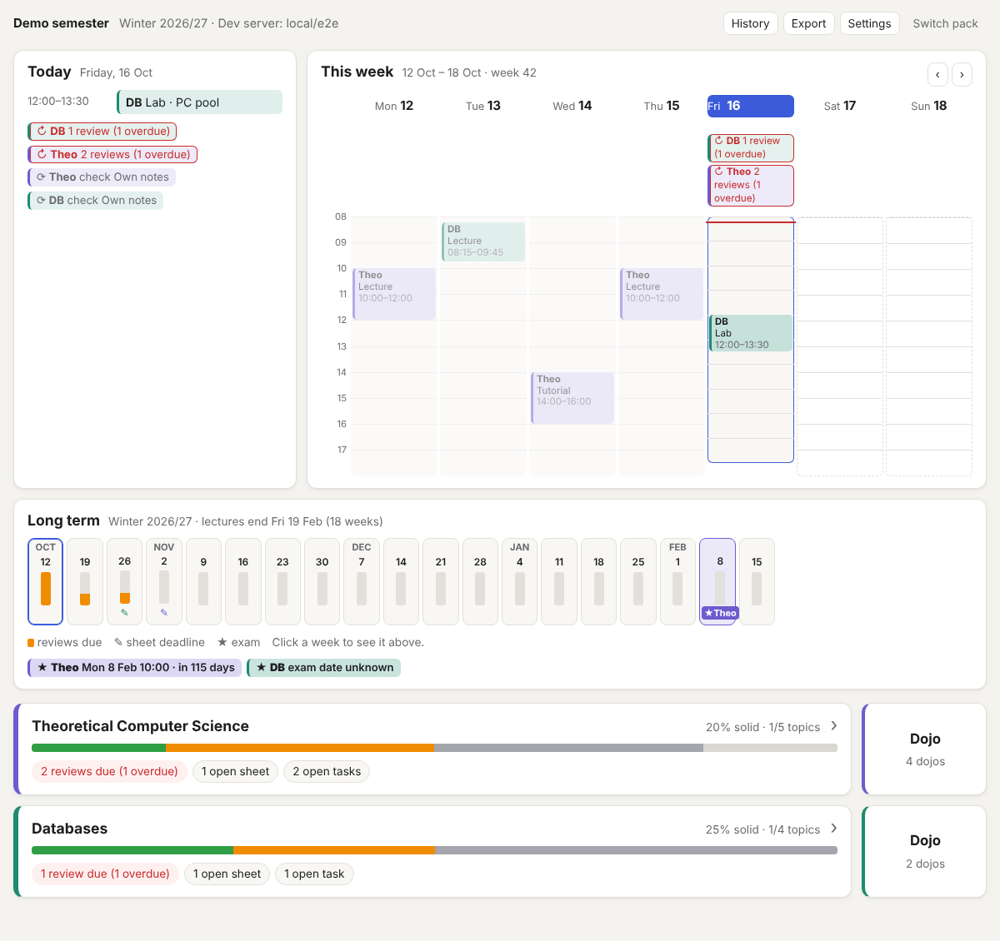

# LearningCenter

A semester dashboard that an AI helps you keep up to date. Works for any
student and any subject: you see at a glance what is coming up, and start a
quiz or a dojo with one click. An AI (Claude or another one) fills in the
data, asks questions that test understanding, grades your answers and plans
the next reviews.



- **Dashboard:** one banner per subject with a progress bar (share of topics
  that are solid) and, below it, flags for due reviews, open sheets and open
  tasks. Subjects with dojos get a Dojo button right next to their banner.
  Above them, a calendar: **Today** (top left) lists today's classes and
  what is due, **This week** (top right) shows your timetable as a week grid
  with reviews, sheet deadlines and exams on their day, so you see when you
  have time to study, and **Long term** shows every week until the end of
  the semester with review load, deadlines and exams. Click a future day's
  reviews to review ahead; click a week to show it in the week view.
  Click a banner to open the subject page with the panels Exam (format, date,
  countdown, allowed aids), Progress, Exercise sheets, Open tasks, Timetable
  and Last checks, plus the buttons Quiz, Dojo and Topics.
- **Exercise sheets:** click a sheet to open it next to an editor and write
  your solutions task by task. The sheet (PDF, image or text) shows on the
  left, your answers save themselves into the pack. Mark it done → checked
  when you are finished.
- **Study:** one button on the dashboard (and in the header) for when you
  don't want to choose. It picks the most pressing topics across all
  subjects: due ones first, the longer overdue the higher, weak topics
  (low recent scores) and subjects with an exam in the next three weeks
  weigh more, then shaky and new topics fill up. It quizzes them subject by
  subject.
- **Quiz:** The AI asks questions that test understanding, one card at a
  time ("Question n/N"), grades them from 0 to 5 and explains gaps; the
  graded cards flip over to show score and feedback. Then spaced repetition takes
  over: topics you know well move on 1 → 3 → 7 → 14 → 21 days, shaky ones
  stay short, and nothing is scheduled on weekends.
- **Dojos:** practice rooms for procedures like NFA → DFA, SQL by hand or
  subnetting. Practice rounds run right in the app: pick a level and a
  count, answer against a timer (multiple choice, short answers, numbers,
  putting steps in order, writing a regex or building an automaton in a
  transition table) and get instant feedback, checked by the app itself.
  Save the round to your progress like a quiz. The AI writes new exercises
  on request, and for free practice it creates tasks and checks your
  solution step by step. Dojos are pure data, new ones need no code.
- **Topic list** per subject with status (new / shaky / solid / skip) and
  due date, also editable by hand.

## Set it up with an AI

The project is built so that an AI can do the setup. Open the repo in Claude
Code (or another AI tool) and say:

> Read ONBOARDING.md and set up LearningCenter for me.

The AI installs everything, asks about your subjects and exams, works out
with you where your course material (e.g. Moodle) and your own notes (e.g.
reMarkable) live, creates your pack and starts the app. Details:
[ONBOARDING.md](ONBOARDING.md).

## Quick start

Requirement: Node.js 18.19 or newer.

```bash
npm install
npm run dev
```

The app opens in your browser by itself (otherwise go to
<http://localhost:5173>). Choose **Try the demo**. The demo
lives in browser storage and has two subjects.

## Create your own pack

All data lives in a **learning pack**: a folder of JSON files. Personal packs
belong in `local/`. That folder is excluded via `.gitignore`, so your study
data stays on your computer, even if you share the repo with others.

```bash
cp -r packs/empty local/my-semester
```

Then either fill it in by hand (see `packs/empty/GUIDE.md`) or start Claude
Code in the repo and say: *"Create a pack in local/my-semester for me. My
subjects and exams: …"*. The rules for the AI are in
[`CLAUDE.md`](CLAUDE.md).

Open it in one of two ways:

| Way | Browser | How |
| --- | --- | --- |
| Dev server | all | `LC_PACK_DIR=local/my-semester npm run dev` |
| Open folder | Chrome, Edge | Choose **Open pack folder …** in the app |

Either way the app writes straight to the files. If an AI changes the files
at the same time, the app reloads them within a few seconds.

Check that a pack is valid: `npm run validate -- local/my-semester`

## Connect an AI

Under **Settings → AI connection** you pick one of three ways. All of them
use the same prompts (`prompts/`) and the same answer format.

1. **File bridge (Claude Code):** Clicking "Quiz" writes a request to
   `inbox/` in the pack folder. In the pack folder, run
   `claude "Process the inbox"`. Claude Code writes the answer to `outbox/`,
   and the app shows it. Needs an open pack folder.
2. **API:** Direct, with your own API key, either Anthropic (Claude) or an
   OpenAI-compatible service (OpenAI, OpenRouter, locally with Ollama). The
   key is stored only in this browser's `localStorage`, never in the pack and
   never in an export.
3. **Copy-Prompt:** The app shows a ready-made prompt. You paste it into any
   AI chat and copy the JSON answer back.

The AI answers in the pack's language, which is English by default. If you
want German quiz questions, set **Settings → Study plan → AI language** to
Deutsch (or `settings.language: "de"` in `pack.json`).

It also works without the app: tell Claude Code in the repo *"Quiz me on
databases"*. It asks the questions in the chat and records the results with
`npm run review`, following the same rules as the app.

## Data format

The format is open and documented with JSON Schema (`schema/`):

```
<pack>/
  pack.json              title, semester, settings, subject and dojo IDs
  subjects/<id>.json     exam, timetable, topics with history, exercise sheets, open tasks, checks
  dojos/<id>.json        dojo definitions
  sessions/<id>.json     logs of quizzes and dojos
  work/<subject>/<sheet>.json  your answers to an exercise sheet
  material/, notes/      scripts, sheet PDFs, timetable and your own notes (not exported)
  log/events.jsonl       event log: what was clicked and answered
  inbox/, outbox/        requests and answers of the file bridge
```

**Export** (top right) downloads the whole pack as one `.pack.json` file,
**Import** loads such a file again (start screen via **Import pack file …**,
or Settings).

Included:

- `packs/demo/`: "Demo semester" with Theoretical Computer Science and
  Databases, including dojos
- `packs/empty/`: empty template with a guide
- `packs/dojo-library/`: more dojos (math: continuity; networks: subnetting,
  fragmentation, routing) to copy

## As a static site (GitHub Pages)

`npm run build` creates a static site in `dist/`. The workflow
`.github/workflows/pages.yml` publishes it on every push to `main`.
Enable it once: **Settings → Pages → Source: GitHub Actions**.

On the static site, packs live in browser storage or in an opened folder
(Chrome/Edge). The dev server way is not available there.

## Development

| Command | Purpose |
| --- | --- |
| `npm run dev` | Dev server, optionally with `LC_PACK_DIR=<folder>` |
| `npm run build` | Type check and static build |
| `npm test` | Tests (Vitest) |
| `npm run validate [-- <folder>]` | Check packs against the schema |
| `npm run review -- <folder> <subject> <topic> <0-5>` | Record a grade and reschedule |

Stack: Vite, TypeScript, Preact, Ajv. No backend. Structure and conventions
are in [`CLAUDE.md`](CLAUDE.md), part B.
